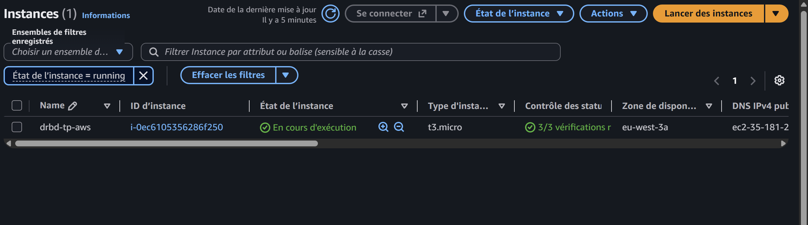
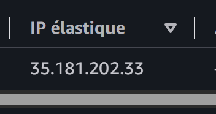
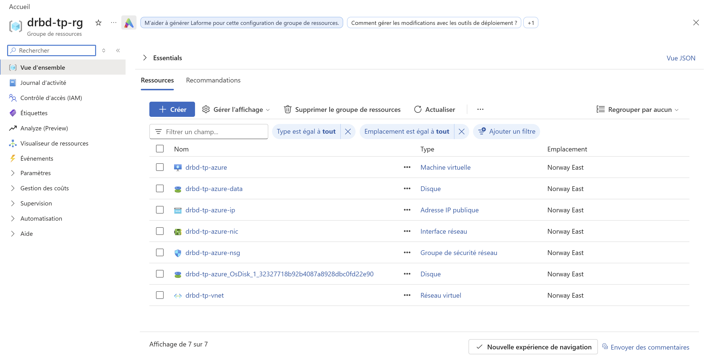

# Exercice 2 — Réplication DRBD d'un LV entre AWS et Azure

Un logical volume LVM est répliqué de façon synchrone (DRBD 9, protocole C)
entre une VM Rocky Linux 9 chez AWS et une VM Rocky Linux 9 chez Azure.
Un seul `terraform apply` crée les deux côtés : un seul root module et deux
providers, pour que chaque VM connaisse l'IP publique de son pair.

## Architecture

```
            AWS eu-west-3 (Paris)                    Azure norwayeast (Oslo)
  ┌─────────────────────────────────┐      ┌─────────────────────────────────┐
  │ VPC 10.10.0.0/16 + IGW          │      │ VNet 10.20.0.0/16               │
  │  drbd-aws  (t3.micro)           │      │  drbd-azure (Standard_B2ats_v2) │
  │   EBS 4 Go -> vg_drbd/lv_drbd   │      │   disque 4 Go -> vg_drbd/lv_drbd│
  │   /dev/drbd0  PRIMAIRE          │      │   /dev/drbd0  SECONDAIRE        │
  │   XFS monté sur /srv/drbd       │      │                                 │
  │  Elastic IP ────────────────────┼──────┼──── IP publique statique       │
  └─────────────────────────────────┘ TCP  └─────────────────────────────────┘
                                      7789
```

- **Pile de stockage** (sur chaque nœud) : disque de données, PV, VG `vg_drbd`, LV `lv_drbd` (1 Go), `/dev/drbd0`, XFS (sur le primaire seulement).
- **Réseau** : les deux clouds font un NAT 1:1. Chaque VM ne voit que son IP privée. Le fichier `/etc/drbd.d/r0.res` diffère donc d'un nœud à l'autre : la section locale porte l'IP privée (écoute), celle du pair son IP publique (connexion).
- **Filtrage** : le port 7789 et l'ICMP sont ouverts uniquement à l'IP `/32` du pair. Le SSH est ouvert uniquement à `admin_cidr`, l'IP publique de l'admin détectée automatiquement par défaut.
- **Démarrage** : `templates/drbd-node.sh.tftpl`, exécuté par cloud-init. Il crée le LVM, installe DRBD depuis ELRepo (`kmod-drbd9x`, `drbd9x-utils`), écrit la ressource, puis lance `create-md` et `up`. Le primaire est promu et formaté.

## Choix pour limiter les coûts

| Poste | Choix | Pourquoi |
|---|---|---|
| VM AWS | `t3.micro`, `cpu_credits = "standard"` | éligible offre gratuite ; pas de facturation CPU « unlimited » |
| VM Azure | `Standard_B2ats_v2` | taille B la moins chère autorisée par l'abonnement Student |
| Région Azure | `norwayeast` | la policy Student n'autorise que 5 régions ; la série B n'est pas ouverte en France Central |
| Réseau AWS | VPC + IGW, **pas de NAT Gateway** | une NAT Gateway coûte environ 35 $/mois |
| Liaison | IP publiques + filtrage `/32`, **pas de VPN Gateway** | une VPN Gateway Azure coûte plus de 25 $/mois |
| Disques | 4 Go HDD/gp3, LV de 1 Go | synchro initiale courte et peu de trafic sortant |

**Après chaque séance, lancer `terraform destroy`.** Arrêter les VM ne suffit pas : les disques et les IP publiques restent facturés.

## Prérequis (une seule fois)

```bash
aws sts get-caller-identity   # utilisateur IAM avec AmazonEC2FullAccess
az account show               # abonnement Azure actif
az vm image terms accept --publisher resf --offer rockylinux-x86_64 --plan 9-base
cp terraform.tfvars.example terraform.tfvars   # renseigner azure_subscription_id
```

## Déploiement

```bash
terraform init
terraform plan -out=tfplan
terraform apply tfplan
```

Le bootstrap prend 3 à 5 minutes après l'`apply` (installation de DRBD). Pour le suivre :

```bash
$(terraform output -raw ssh_aws) 'sudo tail -f /var/log/drbd-bootstrap.log'
```

## Vérification

```bash
# État de la réplication (sur l'un ou l'autre nœud)
sudo drbdadm status r0
#  r0 role:Primary
#    disk:UpToDate
#    drbd-azure role:Secondary
#      peer-disk:UpToDate

cat /srv/drbd/hello.txt      # fichier écrit par le primaire au démarrage
```

### Test de bascule (AWS vers Azure)

```bash
# sur drbd-aws
sudo umount /srv/drbd
sudo drbdadm secondary r0

# sur drbd-azure
sudo drbdadm primary r0
sudo mkdir -p /srv/drbd && sudo mount /dev/drbd0 /srv/drbd
cat /srv/drbd/hello.txt      # même contenu, répliqué depuis AWS
```

## Validation réelle (03/11/2026)

Testé de bout en bout : `apply` (24 ressources), synchro initiale du LV de
1 Go en moins d'une minute, puis bascule AWS vers Azure. Le fichier écrit
sur AWS est relu sur Azure après promotion. Le `destroy` a suivi.

Deux problèmes rencontrés au premier essai, corrigés dans le template :
- `GPG check FAILED` : ELRepo signe avec sa clé v2, que le paquet
  `elrepo-release` de Rocky ne référence pas. Le template l'importe
  explicitement.
- `dnf` bloqué côté Azure : le `mirrorlist` d'ELRepo renvoyait vers un
  miroir injoignable depuis `norwayeast`. Le template utilise `baseurl`
  directement.

## Preuves

### Ressources déployées

Instance AWS `drbd-tp-aws` (`t3.micro`, `eu-west-3a`) en cours d'exécution, 3/3 vérifications :



Elastic IP associée (IP utilisée par le pair Azure pour DRBD) :



Groupe de ressources Azure `drbd-tp-rg` (Norway East) : VM, disque de données, IP publique, NIC, NSG, disque OS, VNet :



### Réplication et bascule (sorties relevées pendant le test)

Synchro initiale en cours, côté AWS :

```
r0 role:Primary
  disk:UpToDate open:yes
  drbd-azure role:Secondary
    replication:SyncSource peer-disk:Inconsistent done:65.82
```

Poignée de main DRBD entre les deux clouds (`journalctl -k`, côté Azure) :

```
drbd r0 drbd-aws: Handshake to peer 0 successful: Agreed network protocol version 125
drbd r0 drbd-aws: conn( Connecting -> Connected ) peer( Unknown -> Primary ) [remote]
```

Synchro terminée, côté Azure :

```
r0 role:Secondary
  disk:UpToDate open:no
  drbd-aws role:Primary
    peer-disk:UpToDate
```

Bascule : écriture sur AWS, démontage et passage en secondaire, puis promotion d'Azure :

```
# drbd-aws
Écrit sur drbd-aws le 2026-11-03T09:40:19+00:00
test bascule 2026-11-03T09:49:35+00:00
r0 role:Secondary
  disk:UpToDate open:no
  drbd-azure role:Secondary
    peer-disk:UpToDate

# drbd-azure, après drbdadm primary + mount
Écrit sur drbd-aws le 2026-11-03T09:40:19+00:00
test bascule 2026-11-03T09:49:35+00:00
r0 role:Primary
  disk:UpToDate open:yes
  drbd-aws role:Secondary
    peer-disk:UpToDate
```

Le fichier écrit sur AWS est relu à l'identique sur Azure.

## Destruction

```bash
terraform destroy
```

## Limites connues (contexte TP)

- **Trafic DRBD en clair sur Internet.** Le filtrage `/32` limite qui peut se connecter, mais les données ne sont pas chiffrées. En production, faire passer DRBD dans un tunnel WireGuard ou IPsec (VPN Gateway, au prix du coût).
- **Protocole C sur un WAN** (environ 30 ms Paris–Oslo) : chaque écriture attend l'acquittement distant. Le protocole A (asynchrone) serait plus rapide, avec un risque de perte des dernières écritures.
- **Pas de gestionnaire de cluster** (Pacemaker) ni de quorum. La bascule est manuelle et rien n'empêche un split-brain. Avec 2 nœuds, un 3e nœud « diskless tiebreaker » serait nécessaire pour un quorum DRBD.
