# Exercice 2 — Réplication DRBD d'un LV entre AWS et Azure

Un logical volume LVM est répliqué de façon synchrone (DRBD 9, protocole C)
entre une VM Rocky Linux 9 chez AWS et une VM Rocky Linux 9 chez Azure.
Un seul `terraform apply` crée les deux côtés : un seul root module et deux
providers, pour que chaque VM connaisse l'IP publique de son pair.

## Architecture

```
         AWS eu-west-3 (Paris)                   Azure norwayeast (Oslo)
  ┌─────────────────────────────────┐      ┌─────────────────────────────────┐
  │ VPC 10.10.0.0/16 + IGW          │      │ VNet 10.20.0.0/16               │
  │  drbd-aws (t3.micro)            │      │  drbd-azure (B2ats_v2)          │
  │  EBS 4 Go -> vg_drbd/lv_drbd    │      │  disque 4 Go -> vg_drbd/lv_drbd │
  │  /dev/drbd0  PRIMAIRE           │      │  /dev/drbd0  SECONDAIRE         │
  │  XFS monté sur /srv/drbd        │      │                                 │
  │ Elastic IP ─────────────────────┼──────┼──── IP publique statique        │
  └─────────────────────────────────┘ TCP  └─────────────────────────────────┘
                                      7789
```

- **Pile de stockage** (sur chaque nœud) : disque de données, PV, VG `vg_drbd`, LV `lv_drbd` (1 Go), `/dev/drbd0`, XFS (sur le primaire seulement).
- **Réseau** : les deux clouds font un NAT 1:1. Chaque VM ne voit que son IP privée. Le fichier `/etc/drbd.d/r0.res` diffère donc d'un nœud à l'autre : la section locale porte l'IP privée (écoute), celle du pair son IP publique (connexion).
- **Filtrage** : le port 7789 et l'ICMP sont ouverts uniquement à l'IP `/32` du pair. Le SSH est ouvert uniquement à `admin_cidr`, l'IP publique de l'admin détectée automatiquement par défaut.
- **Démarrage** : `templates/drbd-node.sh.tftpl`, exécuté par cloud-init. Il crée le LVM, installe DRBD depuis ELRepo (`kmod-drbd9x`, `drbd9x-utils`), écrit la ressource, puis lance `create-md` et `up`. Le primaire est promu et formaté.

## Choix pour limiter les coûts

| Poste | Choix | Pourquoi |
|---|---|---|
| VM AWS | `t3.micro`, `cpu_credits = "standard"` | éligible offre gratuite ; pas de facturation CPU « unlimited » |
| VM Azure | `Standard_B2ats_v2` | taille B la moins chère autorisée par l'abonnement Student |
| Région Azure | `norwayeast` | la policy Student n'autorise que 5 régions ; la série B n'est pas ouverte en France Central |
| Réseau AWS | VPC + IGW, **pas de NAT Gateway** | une NAT Gateway coûte environ 35 $/mois |
| Liaison | IP publiques + filtrage `/32`, **pas de VPN Gateway** | une VPN Gateway Azure coûte plus de 25 $/mois |
| Disques | 4 Go HDD/gp3, LV de 1 Go | synchro initiale courte et peu de trafic sortant |

**Après chaque séance, lancer `terraform destroy`.** Arrêter les VM ne suffit pas : les disques et les IP publiques restent facturés.

## Prérequis (une seule fois)

```bash
aws sts get-caller-identity   # utilisateur IAM avec AmazonEC2FullAccess
az account show               # abonnement Azure actif
az vm image terms accept --publisher resf --offer rockylinux-x86_64 --plan 9-base
cp terraform.tfvars.example terraform.tfvars   # renseigner azure_subscription_id
```

## Déploiement

```bash
terraform init
terraform plan -out=tfplan
terraform apply tfplan
```

Le bootstrap prend 3 à 5 minutes après l'`apply` (installation de DRBD). Pour le suivre :

```bash
$(terraform output -raw ssh_aws) 'sudo tail -f /var/log/drbd-bootstrap.log'
```

## Vérification

```bash
# État de la réplication (sur l'un ou l'autre nœud)
sudo drbdadm status r0
#  r0 role:Primary
#    disk:UpToDate
#    drbd-azure role:Secondary
#      peer-disk:UpToDate

cat /srv/drbd/hello.txt      # fichier écrit par le primaire au démarrage
```

### Test de bascule (AWS vers Azure)

```bash
# sur drbd-aws
sudo umount /srv/drbd
sudo drbdadm secondary r0

# sur drbd-azure
sudo drbdadm primary r0
sudo mkdir -p /srv/drbd && sudo mount /dev/drbd0 /srv/drbd
cat /srv/drbd/hello.txt      # même contenu, répliqué depuis AWS
```

## Validation réelle (03/11/2026)

Deux déploiements complets ont été faits.

1. **Premier `apply`** : il a révélé deux problèmes dans le script de démarrage.
   - `GPG check FAILED` : ELRepo signe avec sa clé v2, que le paquet `elrepo-release` de Rocky ne référence pas. Le template importe la clé explicitement.
   - `dnf` bloqué côté Azure : le `mirrorlist` d'ELRepo renvoyait vers un miroir injoignable depuis `norwayeast`. Le template passe par `baseurl`.
2. **Second `apply`**, avec le template corrigé : tout s'enchaîne sans intervention manuelle. Les captures ci-dessous viennent de ce déploiement.

Le bootstrap AWS dure environ 12 minutes, contre 3 côté Azure. `cpu_credits = "standard"` évite toute facturation CPU, mais bride le `t3.micro` à 10 % par vCPU. La reconstruction de l'initramfs par `dracut`, à l'installation du module DRBD, est donc lente.

## Preuves

### 1. Déploiement Terraform

`terraform apply` : 24 ressources créées, IP publiques des deux nœuds en sortie.

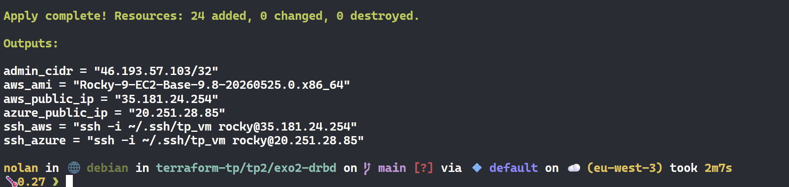

Instance AWS `drbd-tp-aws` (`t3.micro`, `eu-west-3a`) en cours d'exécution, avec son Elastic IP :

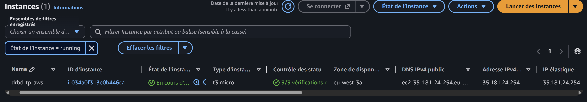

Groupe de ressources Azure `drbd-tp-rg` (Norway East) : VM, disque de données, IP publique, NIC, NSG, disque OS, VNet :

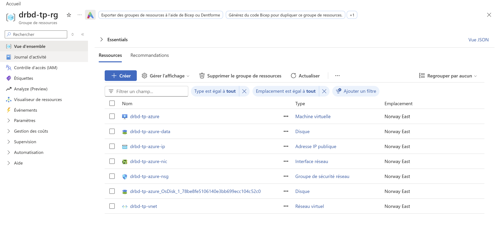

### 2. Bootstrap (cloud-init), journal `/var/log/drbd-bootstrap.log` côté AWS

Création de la pile LVM sur le disque de données (`/dev/nvme1n1`, PV, `vg_drbd`, `lv_drbd`) :

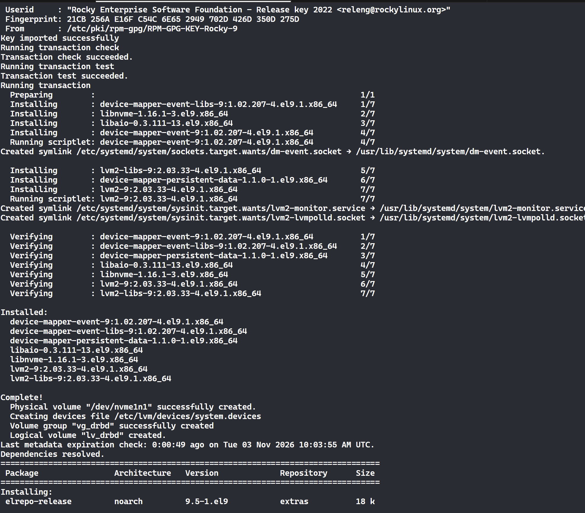

Installation de DRBD 9 depuis ELRepo (`kmod-drbd9x`, `drbd9x-utils`) :

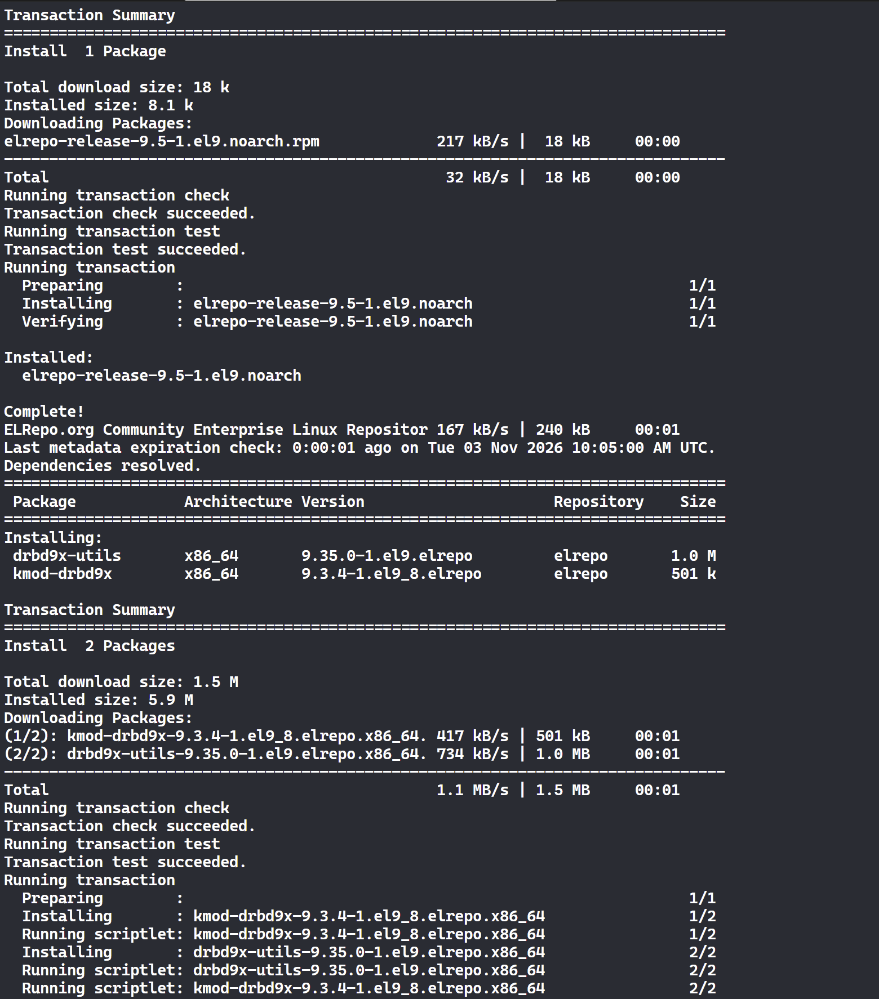

Métadonnées DRBD, XFS sur `/dev/drbd0`, promotion en primaire. La synchro initiale vers Azure démarre (`SyncSource ... done:0.15`) :

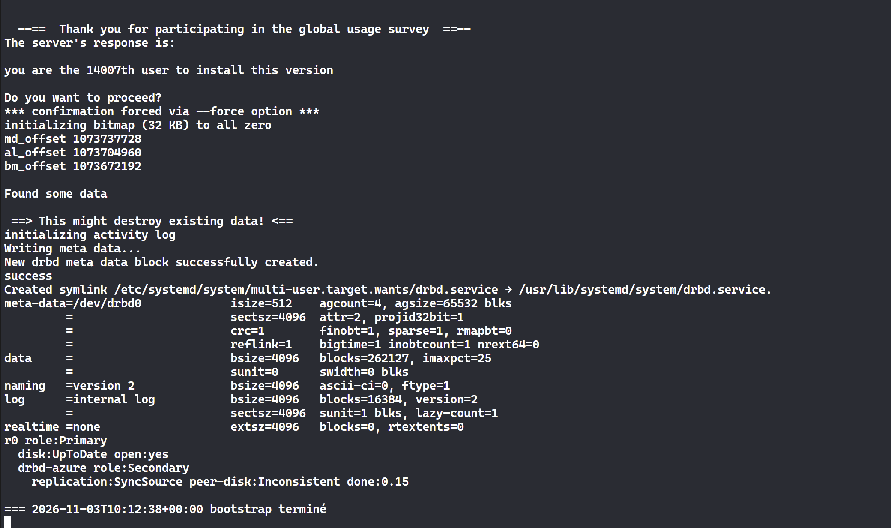

### 3. Réplication établie

Les deux nœuds sont `UpToDate` : AWS primaire, Azure secondaire.

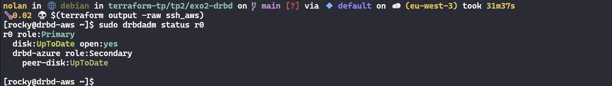
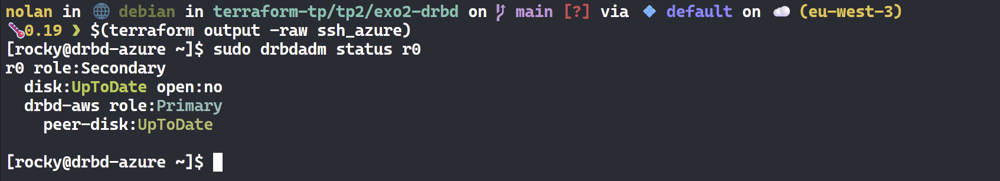

### 4. Pile de stockage identique sur les deux clouds

Disque de 4 Go, `vg_drbd-lv_drbd` (1 Go), `drbd0`. Sur AWS, `drbd0` est monté sur `/srv/drbd` (primaire) ; sur Azure, il n'est pas monté (secondaire). Le nom du disque diffère (`nvme1n1` / `sdb`) : le script le repère par sa taille.

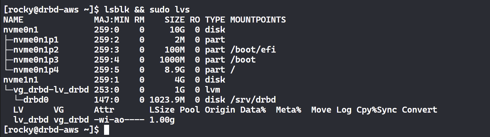
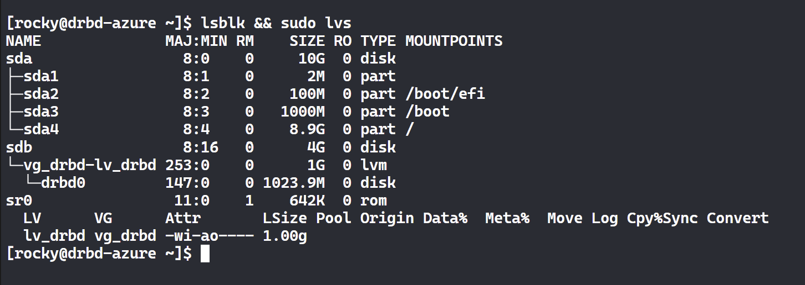

### 5. Bascule AWS vers Azure

Sur AWS : écriture dans `hello.txt`, démontage, passage en secondaire.

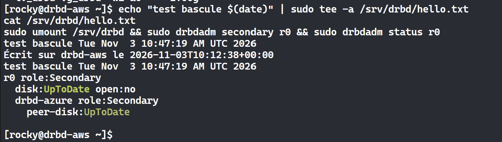

Sur Azure : promotion en primaire, montage. Le fichier écrit sur AWS est relu à l'identique, et AWS est devenu secondaire `UpToDate`.

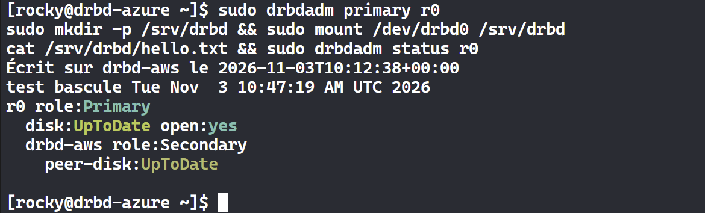

### 6. Configuration DRBD : IP privée locale, IP publique du pair

Les deux fichiers `/etc/drbd.d/r0.res` diffèrent volontairement. Chaque nœud écoute sur sa propre IP privée (`10.10.1.189` sur AWS, `10.20.1.4` sur Azure) et joint son pair sur l'IP publique de celui-ci, à cause du NAT 1:1 des deux clouds.

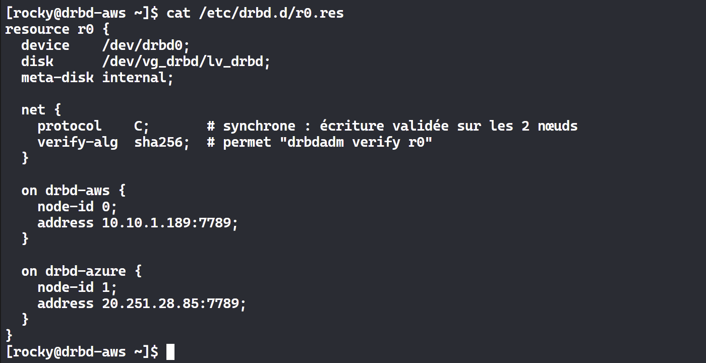
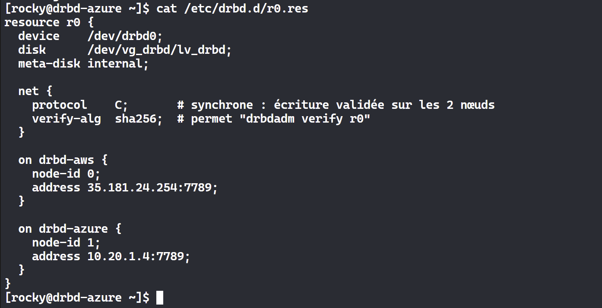

### 7. Filtrage réseau

NSG Azure : SSH ouvert uniquement à l'IP d'administration, port DRBD 7789 et ICMP ouverts uniquement à l'IP publique AWS (`/32`). Tout le reste est refusé (`DenyAllInBound`).

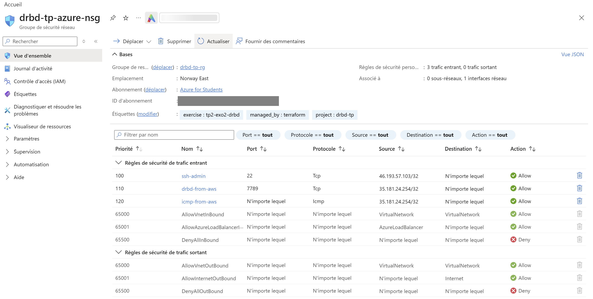

Security group AWS : trois règles entrantes seulement, port 7789, ICMP et SSH 22. Les sources, en `/32`, sont définies dans `aws.tf` : l'IP publique Azure pour 7789 et ICMP, l'IP d'administration pour 22.

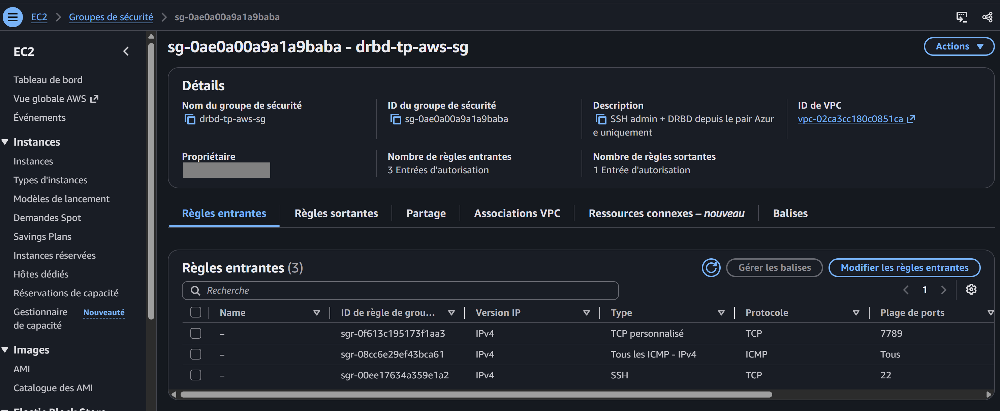

Les identifiants de compte AWS et d'abonnement Azure sont masqués sur les captures.

### 8. Nettoyage

```
Destroy complete! Resources: 24 destroyed.
```

Contrôle après le `destroy` : state Terraform vide. Côté AWS, aucune instance, aucun volume, aucune Elastic IP, aucune NAT Gateway, aucun snapshot, aucun VPC ni clé `drbd-tp`, dans aucune région. Côté Azure, `drbd-tp-rg` a disparu ; il ne reste que `NetworkWatcherRG`, créé automatiquement par Azure et gratuit.

## Destruction

```bash
terraform destroy
```

## Limites connues (contexte TP)

- **Trafic DRBD en clair sur Internet.** Le filtrage `/32` limite qui peut se connecter, mais les données ne sont pas chiffrées. En production, faire passer DRBD dans un tunnel WireGuard ou IPsec (VPN Gateway, au prix du coût).
- **Protocole C sur un WAN** (environ 30 ms Paris–Oslo) : chaque écriture attend l'acquittement distant. Le protocole A (asynchrone) serait plus rapide, avec un risque de perte des dernières écritures.
- **Pas de gestionnaire de cluster** (Pacemaker) ni de quorum. La bascule est manuelle et rien n'empêche un split-brain. Avec 2 nœuds, un 3e nœud « diskless tiebreaker » serait nécessaire pour un quorum DRBD.
